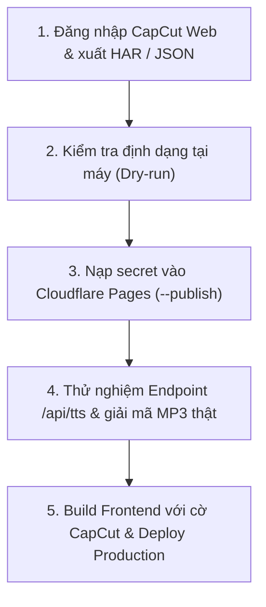

# Hướng dẫn kết nối và vận hành CapCut TTS v2

Tài liệu này hướng dẫn chi tiết quy trình đưa phiên đăng nhập CapCut của bạn vào hệ thống Private Novel Reader, kiểm tra nghiệm thu âm thanh thật và phát hành gateway lên production.

> [!IMPORTANT]
> **Nguyên tắc an toàn bảo mật:**
> - Tuyệt đối không gửi cookie, mật khẩu, token hoặc file HAR vào khung chat/Git repository.
> - Thao tác trích xuất và đẩy cấu hình được thực hiện hoàn toàn cục bộ trên máy bạn, chuyển trực tiếp vào Cloudflare Pages Secret qua `stdin`.
> - Không thu thập mật khẩu/cookie trên giao diện Reader; cookie cập nhật chỉ lưu AES-GCM trong bảng runtime riêng; không vào backup, shared state hay frontend bundle.
> - Tuyệt đối không dùng thông tin định danh mẫu từ các repository tham khảo. Ổ `D:` chỉ dùng để đọc tham khảo, không lưu file phiên hoặc tải lên.

---

## Khôi phục lựa chọn CapCut mặc định (01/11/2026)

- Bundle production `index-ColL-hhl.js` được kiểm tra chứa gateway TikTok cũ và không chứa `/api/tts`; request tổng hợp cùng origin đến `/api/tts` trả HTTP 200 và audio base64. Điều này xác định lỗi lựa chọn frontend trong bản đang chạy; chưa chứng minh nguyên nhân thiếu biến ở lần build cụ thể hoặc xác minh phát audio qua trình duyệt.
- Code nay mặc định dùng CapCut kể cả khi thiếu `VITE_TTS_GATEWAY`, đồng bộ catalog và nhãn giao diện; chỉ giá trị `legacy-tiktok` chủ động chọn gateway cũ. Phiên vẫn chỉ nằm trên server. Bản sửa chưa deploy. Vitest TTS selector/recovery: 9/9 đạt; E2E Chromium dev-server dừng sau test đầu timeout tại `page.goto`, chưa vào luồng TTS; chưa xác minh browser/Android.
- Tham khảo [Vite Env Variables and Modes](https://vite.dev/guide/env-and-mode): biến `import.meta.env` được thay tĩnh khi build; áp dụng mặc định an toàn ngay trong selector để build thông thường không phụ thuộc biến shell. Catalog giữ nguồn [jutlyne/capcut-tts](https://github.com/jutlyne/capcut-tts), không thay giao thức hay thêm dependency.

## Trạng thái hiện hành

- Đã bật CapCut v2 trên Pages `d07fdcd9`, bundle `index-BT12ui5x.js` (sửa tự nghe tiếp, giữ gateway/phiên CapCut và cấu hình AI), dùng `/api/tts` và phiên riêng trong server secret.
- Đã xác minh giọng nữ `BV074_streaming` với phiên thật, ba đoạn qua production và thao tác player bằng truyện tổng hợp cô lập cloud. Android thật/chạy nền chưa xác minh.
- Có 10 giọng Việt đã tạo MP3 và được Edge giải mã/phát: Cô Gái Hoạt Ngôn, Thanh Niên Tự Tin, Nhỏ Ngọt Ngào, Giọng Nữ Phổ Thông, Giọng Bé, Việt Méo, Mai, Kenny Đại Đế, Robot VN, Alex Đại Đế. Chọn trong Cài đặt đọc truyện → Nghe sách → Giọng. Hai ID cũ giữ nguyên; catalog chung với server/cursor/sync.
- Tự giữ cookie mới nếu endpoint CapCut cấp; `CAPCUT_SESSION_PERSISTENCE=1`, bảng runtime0015. Không lưu mật khẩu hoặc tự đăng nhập. Khi hết phiên, giữ mốc và chờ thử lại60giây; server hạn chế gọi phiên hỏng5phút. Cookie bootstrap mới có namespace riêng nên nhận ngay ở lượt thử kế tiếp.
- Audio cache riêng trên máy32MiB/256đoạn/24giờ; dọn cache không dọn cursor. Bộ đệm thích nghi12–45giây, tối đa12đoạn giữ lại/3request đang chạy. Tải lại chờ người dùng nhấn Nghe.
- CapCut Web hiện gửi `tdid=web`, `appvr=15.4.0`; helper/backend giữ nguyên các giá trị thực tế này (tdid chỉ nhận số, rỗng hoặc đúng `web`).
- Quy trình dưới dùng để kết nối lại khi phiên hết hạn; không gửi cookie/HAR vào chat. Rollback frontend: Pages `8b4c4073` (secret không tự bị xóa khi rollback).

### Giới hạn nối lại phiên (xác minh 25/10/2026)

- Đã xác minh endpoint production tạo audio với phiên hiện có; chưa có cầu nối để đăng nhập CapCut trên điện thoại rồi tự cập nhật phiên cho server.
- Cơ chế lưu `Set-Cookie` đã được kiểm bằng fixture workerd; chưa quan sát được CapCut thật cấp cookie mới qua endpoint TTS. Không coi đây là bằng chứng tự gia hạn hoặc duy trì phiên vĩnh viễn.
- Ngày hết hạn cookie trong trình duyệt chỉ là metadata phía trình duyệt, không xác nhận thời hạn chấp nhận phiên ở upstream/server.
- Chưa xác minh được đăng nhập email chỉ bằng OTP cho tài khoản hiện dùng. Không ghép luồng đăng ký/khôi phục mật khẩu thành luồng đăng nhập, không thêm form nối lại chưa hoạt động.

---

## Quy trình 5 bước kết nối và kích hoạt



---

### Bước 1: Lấy phiên trên máy cá nhân

Bạn cần một phiên đăng nhập còn hiệu lực trên CapCut Web có quyền sử dụng giọng đọc tiếng Việt.

1. Truy cập [CapCut Web Editor](https://www.capcut.com/editor) trên trình duyệt cá nhân (Chrome, Edge,...).
2. Mở **Developer Tools** (nhấn `F12` hoặc `Ctrl + Shift + I`), chuyển sang tab **Network** (Mạng).
3. Trong ô lọc (Filter), nhập `multi_platform` hoặc `edit-api-sg.capcut.com`.
4. Trong giao diện CapCut Web:
   - Thêm một đoạn văn bản ngắn (Text).
   - Chọn tính năng **Text to Speech** (Chuyển văn bản thành giọng nói).
   - Chọn ngôn ngữ **Tiếng Việt** và chọn giọng **Cô Gái Hoạt Ngôn** (`BV074_streaming`).
   - Nhấn tạo âm thanh để kích hoạt request mạng.
5. Khi thấy request `POST` gửi đến `https://edit-api-sg.capcut.com/storyboard/v1/tts/multi_platform`:
   - **Cách 1 (Xuất file HAR):** Click chuột phải vào request → chọn **Save all as HAR with content** (hoặc *Export HAR*).
     > [!WARNING]
     > Trình duyệt Chrome/Edge có thể có tùy chọn *"Sanitize HAR"* hoặc *"Bỏ thông tin nhạy cảm"* khi xuất file. Nếu tùy chọn này được bật, cookie sẽ bị xóa và helper sẽ từ chối file. Hãy lưu file HAR vào một thư mục an toàn ngoài Git (ví dụ: `C:\secrets\capcut.har`).
   - **Cách 2 (Tạo file JSON thủ công):** Tạo file `capcut-session.json` tại một thư mục ngoài Git (hoặc trong `.dsh-tmp/` đã được gitignore) với cấu trúc sau:
     ```json
     {
       "cookie": "sessionid=...; sid_tt=...; (chuỗi Cookie đầy đủ trong request headers)",
       "deviceId": "1234567890123456",
       "tdid": "",
       "region": "VN",
       "appVersion": "5.8.0"
     }
     ```
     *(Lấy giá trị `Cookie` từ Request Headers, `did` tương ứng với `deviceId`, `tdid` nếu có, `appvr` tương ứng với `appVersion`).*

---

### Bước 2: Kiểm tra định dạng phiên tại máy (Dry-run)

Mở terminal PowerShell tại thư mục `private-novel/` và chạy lệnh kiểm tra cú pháp (chưa gửi dữ liệu đi, chưa gọi cloud):

```powershell
node scripts/configure-capcut-session.mjs --file "C:\secrets\capcut.har"
```
*(Thay đường dẫn `"C:\secrets\capcut.har"` bằng đường dẫn file thực tế của bạn).*

- **Yêu cầu bảo mật của helper:**
  - File không được nằm trên ổ `D:`.
  - File nếu nằm trong repository bắt buộc phải thuộc danh sách `.gitignore` (như thư mục `.dsh-tmp/`).
  - Dung lượng file tối đa 64 MiB.
- **Kết quả thành công mong đợi:**
  ```text
  Đã kiểm định dạng phiên tại máy. Chưa gửi dữ liệu lên server; chưa xác minh phiên còn hạn.
  ```

---

### Bước 3: Nạp phiên vào Cloudflare Pages Secret

Khi file đã hợp lệ, thực hiện nạp trực tiếp vào Cloudflare Pages Secret qua cờ `--publish`:

1. Kiểm tra quyền Cloudflare trên máy:
   ```powershell
   npx wrangler whoami
   ```
   Xác nhận tài khoản đã đăng nhập có quyền truy cập vào Pages project `thu-phong-private`.

2. Đẩy secret vào server:
   ```powershell
   node scripts/configure-capcut-session.mjs --file "C:\secrets\capcut.har" --publish
   ```

- **Cơ chế hoạt động:** Helper sử dụng Wrangler cài đặt trong dự án, chuyển payload JSON chứa đúng 5 trường cấu hình phiên trực tiếp qua `stdin` của lệnh `wrangler pages secret put CAPCUT_SESSION_JSON --project-name thu-phong-private`. Không để lộ cookie trong tham số tiến trình (process arguments) hay stdout/stderr.
- **Kết quả thành công mong đợi:**
  ```text
  Đã lưu CAPCUT_SESSION_JSON vào secret của Pages thu-phong-private. Chưa bật client CapCut hoặc xác minh giọng thật.
  ```

---

### Bước 4: Nghiệm thu âm thanh và quyền giọng đọc (Probe Online)

Sau khi server đã có secret, bạn cần gửi một request thử nghiệm thực tế lên endpoint `/api/tts` trên server production để kiểm tra khả năng giải mã và cấp quyền upstream trước khi bật giao diện người dùng.

Thực hiện trong PowerShell:

```powershell
# 1. Gửi request tổng hợp giọng Cô Gái Hoạt Ngôn
$body = @{
    text = "Xin chào, đây là âm thanh thử nghiệm giọng đọc CapCut v2."
    voice = "BV074_streaming"
} | ConvertTo-Json

$res = Invoke-RestMethod -Uri "https://thu-phong-private.pages.dev/api/tts" `
    -Method Post `
    -ContentType "application/json" `
    -Headers @{ "Origin" = "https://thu-phong-private.pages.dev" } `
    -Body $body

# 2. Xuất file MP3 kiểm tra chất lượng âm thanh
if ($res.success -and $res.data) {
    [IO.File]::WriteAllBytes("test-capcut.mp3", [Convert]::FromBase64String($res.data))
    Write-Host "Tổng hợp thành công! Mở file test-capcut.mp3 để nghe thử." -ForegroundColor Green
} else {
    Write-Host "Lỗi: " ($res | ConvertTo-Json) -ForegroundColor Red
}
```

**Tiêu chí nghiệm thu bước 4:**
1. Endpoint trả về HTTP 200 kèm `success: true`.
2. File `test-capcut.mp3` mở nghe được rõ ràng, đúng ngữ điệu giọng **Cô Gái Hoạt Ngôn**.
3. Thử lặp lại với một câu văn khác có độ dài khoảng 100-150 ký tự để đo độ trễ và cold start.
4. Nếu kiểm tra thất bại, xem mục [Bảng mã lỗi và xử lý sự cố](#bang-ma-loi-va-xu-ly-su-co) bên dưới.

---

### Bước 5: Kích hoạt Client và triển khai Production

Chỉ sau khi bước 4 cho ra âm thanh thật thành công:

1. **Build frontend với cờ kích hoạt CapCut v2:**
   ```powershell
   cd private-novel
   $env:VITE_TTS_GATEWAY="capcut-v2"
   npm.cmd run build
   ```
   *(Lưu ý: `VITE_TTS_GATEWAY` chỉ là cờ chọn gateway phía client `/api/tts`, hoàn toàn không chứa secret hay thông tin nhạy cảm).*

2. **Triển khai dist lên Cloudflare Pages:**
   ```powershell
   npx wrangler pages deploy dist --project-name thu-phong-private --commit-dirty=true
   ```

3. **Kiểm tra trên trình duyệt:**
   - Mở `https://thu-phong-private.pages.dev/`.
   - Vào một chương truyện bất kỳ, mở thanh công cụ → chọn **▶ Nghe sách**.
   - Kiểm tra các thao tác: Bắt đầu phát, Tạm dừng (Pause), Tiếp tục (Resume), Dừng hẳn (Stop) và chuyển chương tự động.
   - Xác nhận cửa sổ tải trước duy trì tối đa ≤ 3 request đồng thời.

---

## Kế hoạch Rollback dự phòng

Nếu xảy ra sự cố phát sinh (phiên bị khóa, upstream CapCut thay đổi hoặc lỗi mạng kéo dài):

1. **Rollback frontend/backend về bản triển khai an toàn trước đó (`a74180c0`):**
   ```powershell
   npx wrangler pages deployment rollback a74180c0 --project-name thu-phong-private
   ```
2. **Hoặc build lại frontend về gateway mặc định:**
   ```powershell
   cd private-novel
   Remove-Item Env:\VITE_TTS_GATEWAY -ErrorAction SilentlyContinue
   npm.cmd run build
   npx wrangler pages deploy dist --project-name thu-phong-private --commit-dirty=true
   ```

---

## Bảng mã lỗi và xử lý sự cố

| Mã lỗi HTTP / Code | Ý nghĩa | Nguyên nhân & Cách khắc phục |
|---|---|---|
| `503` `capcut_not_configured` | Chưa cấu hình phiên | Pages Secret `CAPCUT_SESSION_JSON` chưa được thiết lập. Hãy thực hiện Bước 3. |
| `503` `capcut_configuration_invalid` | Cấu hình sai định dạng | JSON trong secret thiếu trường, vượt độ dài hoặc sai regex. Kiểm tra lại Bước 2. |
| `401` `capcut_session_expired` | Phiên hết hạn / không hợp lệ | Cookie CapCut đã hết hạn hoặc bị đăng xuất. Đăng nhập lại CapCut Web và chạy lại Bước 1, 2, 3. |
| `422` `capcut_request_rejected` | Upstream từ chối yêu cầu | Tài khoản CapCut chưa được cấp quyền dùng giọng đọc này, hoặc request bị chặn chính sách. Kiểm tra tài khoản trên web. |
| `429` `tts_rate_limited` | Vượt hạn mức admission D1 | Đã vượt ngưỡng an toàn bảo vệ: 30 req/phút/IP, 120 req/phút toàn cục hoặc 6.000 req/ngày. Chờ theo giá trị header `Retry-After`. |
| `429` `capcut_busy` | Upstream CapCut báo bận | CapCut upstream trả HTTP 429. Chờ khoảng 30 giây rồi thử lại. |
| `502` `capcut_invalid_audio` | Âm thanh không hợp lệ | File tải về từ CDN không có header MP3 (`ID3` hoặc sync word) hoặc vượt quá 1 MiB. |
| `504` `tts_timeout` | Quá hạn xử lý (Deadline 20s) | Request tổng hợp hoặc tải file audio vượt quá hạn mức deadline 20 giây của adapter. |
| `403` `invalid_origin` | Vi phạm nguồn gốc | Request không gửi đúng header `Origin` khớp với URL Pages hoặc gọi từ cross-site. |
| `400` `invalid_tts_input` | Dữ liệu đầu vào sai | Text vượt quá 200 ký tự unicode, chứa ký tự điều khiển cấm, hoặc mã giọng không thuộc danh sách hỗ trợ. |

---

## Đặc tả kỹ thuật và Hạn mức an toàn

- **Giọng đọc mặc định:**
  - Nữ: `BV074_streaming` (Tên: *Cô Gái Hoạt Ngôn*, Resource ID: `7102355709945188865`).
  - Nam: `BV075_streaming` (Tên: *Thanh Niên Tự Tin*, Resource ID: `7102355803792740865`).
- **Hạn mức adapter:**
  - Giới hạn văn bản: Tối đa 200 Unicode code points cho mỗi request.
  - Deadline xử lý: 20 giây (tự động ngắt kết nối và giải phóng tài nguyên nếu quá hạn).
  - Giới hạn audio: ≤ 1 MiB/file MP3 tải từ CDN được phép (`byteoversea.com`, `ibytedtos.com`, `tiktokcdn.com`, `capcut.com`).
  - Bảo vệ D1 admission: 30 requests/phút/IP, 120 requests/phút toàn cục, 6.000 requests/ngày UTC.
  - Phía trình duyệt: Bộ đệm player duy trì tối đa ≤ 3 requests tải trước; khi bấm Stop hủy ngay lập tức các request đang chờ.

Chi tiết về thiết kế kiến trúc và nhật ký kiểm thử an toàn có tại [CAPCUT-TTS-V2-M0.md](CAPCUT-TTS-V2-M0.md).

01/11/2026: đã deploy Pages d312d26e/index-DiJjPKB2.js, mặc định CapCut. Built E2E18/18 desktop/Android mô phỏng; endpoint thật trả200audio trước deploy. Dừng kiểm thử thêm theo yêu cầu người dùng, chưa Android thật. Chi tiết [khôi phục web](WEB-RECOVERY-2026-11-01.md).

### Giảm chờ phục hồi — 01/11/2026, chưa deploy

Theo yêu cầu người dùng: backoff lỗi tạm thời đổi từ ngay/2/4/8/16/30 giây thành ngay/1/2/4/8 giây, giữ tối đa 8 giây. Timeout client từ 30 xuống 25 giây để vẫn bao phủ deadline server 20 giây và chừa vận chuyển; đây là lựa chọn vận hành, chưa có đo đạc độ trễ upstream mới. Phiên hết hạn kiểm tra mỗi 15 giây thay vì 60; polling không tự khôi phục được phiên không hợp lệ. `Retry-After` vẫn ưu tiên nếu dài hơn. Giữ nguyên cancellation, vị trí nghe/audioTime, cache và giới hạn tải trước.

Tham khảo [yt-dlp RetryManager](https://github.com/yt-dlp/yt-dlp/blob/master/yt_dlp/utils/_utils.py): tách khoảng chờ retry khỏi thao tác mạng và thông báo khoảng chờ; chỉ điều chỉnh thời gian trong player hiện có, không thêm dependency. Không chạy/viết test theo yêu cầu trước đó; build ghi tại `.dsh-tmp/tts-retry-shorter-build.log`. Chưa xác minh nghe thật/hiệu năng upstream; chưa deploy.
Xác minh thay đổi thời gian chờ: build exit0 (tsc client/server + Vite), diff-check0; không test/deploy.

## Deploy 01/11/2026 — bản tổng hợp đã phát hành
Pages **1ea43d81**, asset **index-DDP66Cv4.js**; AI Worker **9f48a8f1-a14c-4841-abec-6e2ab871aeb1**. Deploy exit0. GET production /, /phong-toi, /r/10019/1 và JS asset HTTP200, đúng asset mới; /epub-bridge-v2.js HTTP200 và SHA khớp file build. Logs .dsh-tmp/nov01-final-{worker-deploy,pages-deploy}.log và nov01-final-release.json. Không chạy test/E2E, gọi AI/TTS thật hoặc sửa/xóa dữ liệu người dùng. Bằng chứng GET xác nhận phát hành, không thay cho kiểm chứng thao tác thực tế. Các ghi chú chưa deploy phía trên mô tả trạng thái trước lần phát hành này.
