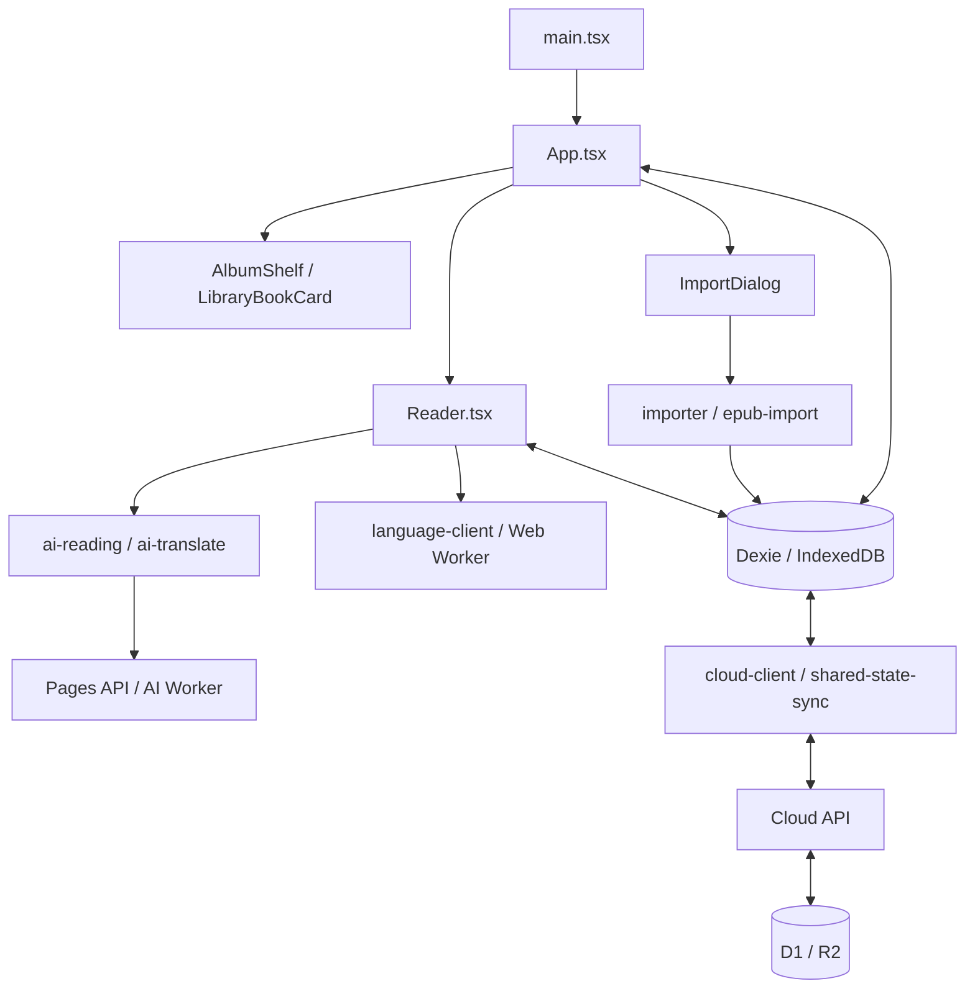

# Báo cáo nghiên cứu và hướng dẫn học Private Novel Reader

Ngày: 16/10/2026. Phạm vi: mã nguồn local hiện tại, bản đồ kiến trúc và một đợt làm gọn phần giao diện. Viết theo mức mới học JavaScript/React; có thể bỏ qua phần thuật ngữ nếu đã quen.

## 1. Kết quả chính

Project đã có nhiều lớp xử lý thực tế: nhập TXT/EPUB, giữ file gốc, Convert, dịch AI, TTS, đồng bộ và khôi phục. Những lớp này giải quyết các tình huống khác nhau; không nên gộp tất cả lại chỉ để giảm số file.

Điểm gây khó học thấy rõ trong các file đã đọc là cách viết dồn nhiều lệnh trên một dòng và việc trộn nhiều trách nhiệm trong component lớn. Ví dụ trước đợt sửa, `App.tsx` có 284 dòng nhưng nhiều dòng chứa cả cụm giao diện; `Reader.tsx` có 449 dòng, dòng dài nhất 2.479 ký tự. Số dòng ít chưa phản ánh code dễ hiểu.

Đợt này đã tạo hai điểm bắt đầu dễ học: `LibraryBookCard` hiển thị một truyện và `AlbumShelf` hiển thị danh sách Album. Đồng thời làm rõ cách đọc `main.tsx` và `common.tsx`. `App.tsx` còn 258 dòng; phần điều phối vẫn phức tạp và chưa được viết lại toàn bộ.

Đây là nghiên cứu cấu trúc và cải thiện một phạm vi cụ thể, không phải chứng nhận toàn bộ hệ thống không có lỗi. Các phần dữ liệu và bảo mật chỉ được đọc để giải thích mối liên hệ, chưa được audit toàn diện trong lượt này.

## 2. Ứng dụng gồm những gì?

| Thành phần | Vai trò trong project | Nơi bắt đầu |
|---|---|---|
| React | Ghép các component thành màn hình, cập nhật khi state thay đổi | `src/ui/` |
| TypeScript | Mô tả kiểu dữ liệu, phát hiện nhiều lỗi khi build | `src/domain.ts` |
| Vite | Chạy giao diện lúc phát triển và đóng gói bản phát hành | `vite.config.ts`, `package.json` |
| Dexie / IndexedDB | Lưu truyện, chương và cài đặt trong trình duyệt | `src/db.ts` |
| Web Worker | Chạy nhập/Convert ở luồng riêng để giảm công việc trên luồng UI | `src/workers/` |
| Pages Functions | Nhận request HTTP tại các đường dẫn API | `functions/api/` |
| Server modules | Thực hiện xử lý cloud, trạng thái chung và AI | `server/` |
| D1 | Lưu dữ liệu dạng bảng ở server | `migrations/`, các module `server/` |
| R2 | Lưu các đối tượng/file phía cloud | `server/cloud-library.ts`, `server/cloud-originals.ts` |
| Vitest | Chạy kiểm tra hàm và logic | `tests/` |
| Playwright | Chạy luồng tương tác trên trình duyệt | `e2e/` |

Đếm tại thời điểm báo cáo, chỉ tính các file `.ts`, `.tsx`, `.mjs`: `src` có 113 file, `server` 14, `functions` 8, `tests` 123, `e2e` 75. Số file test không phải số ca test, cũng không phải bằng chứng tất cả đang pass.

## 3. Bản đồ thư mục

```text
private-novel/
  src/
    main.tsx                 khởi động React
    domain.ts                kiểu Book, Chapter, Progress, ReaderSettings...
    db.ts                    database local và transaction cơ bản
    ui/                      màn hình, hộp thoại, thẻ truyện
    workers/                 xử lý nền trong trình duyệt
    importer.ts              điều phối nhập TXT
    epub-*.ts                đọc, nhập, hiển thị và dịch EPUB
    language*.ts             Convert bằng từ điển
    ai-*.ts                  dịch, chia phần, retry, cache, hybrid
    shared-*.ts              đồng bộ các chỉnh sửa
    cloud-*.ts               giao tiếp kho cloud và file gốc
    tts.ts, tts-cursor.ts     âm thanh và vị trí nghe
  functions/api/             điểm vào HTTP
  server/                    xử lý request phía Cloudflare
  migrations/                thay đổi schema database server
  tests/                     kiểm tra logic
  e2e/                       kiểm tra trải nghiệm trình duyệt
  docs/                      hướng dẫn và tài liệu từng tính năng
  dist/                      kết quả build, không sửa bằng tay
```

`src/workers/` là Web Worker trong trình duyệt. `server/ai-worker.ts` là Cloudflare Worker trên server. Hai loại worker này có môi trường chạy và quyền truy cập khác nhau.

## 4. Luồng hoạt động tổng thể



Sơ đồ mô tả đường đi chính, không liệt kê mọi module. TTS có đường riêng từ trình đọc qua `tts.ts` đến gateway đã cấu hình.

### Khởi động và mở tủ sách

`main.tsx` gọi khởi tạo kết nối thiết bị rồi mount `<App/>`. Lời gọi khởi tạo là bất đồng bộ; code không `await` nó trước khi render. `App` tiếp tục theo dõi việc khởi tạo để quyết định khi nào thực hiện các công việc cloud liên quan.

Trong `App`, `useLiveQuery` đọc những truyện có `status: 'ready'`. Khi dữ liệu local thay đổi, truy vấn được cập nhật và React vẽ lại danh sách. App còn lấy danh mục cloud, ghép các truyện chưa có trên máy vào tủ sách, lọc theo Album/từ khóa, rồi chuyển dữ liệu xuống component hiển thị.

`LibraryBookCard` không biết cách tải truyện. Khi bấm “Mở sách”, nó gọi callback. `App.openShelf` kiểm tra bản local, tải từ cloud nếu cần, rồi điều hướng vào trình đọc.

### Nhập truyện

Luồng nhập đơn đi qua `ImportDialog`: nhận file, kiểm tra lựa chọn, tạo `AbortController`, gọi `importFiles` cho TXT hoặc `importEpub` cho EPUB, sau đó thực hiện bước công bố dữ liệu qua transaction. Các luồng nhiều file/folder có module riêng.

Hai trạng thái cần hiểu là `staging` — bản nhập chưa được công bố — và `ready` — bản đã hoàn tất để xuất hiện trong thư viện. `src/db.ts` cũng có `commitImport`; không nên hiểu rằng mọi giao diện nhập đều gọi trực tiếp hàm này: giao diện hiện tại còn đi qua các hàm công bố gắn với Album.

Giữ trạng thái tạm giúp tránh hiện một truyện chưa nhập xong. Hủy tác vụ phải xử lý cả worker lẫn lệnh ghi database còn đang chạy; đây là lý do phần nhập có nhiều kiểm tra hơn một ví dụ CRUD cơ bản.

### Đọc RAW, Convert và AI

| Chế độ | Cách tạo nội dung hiển thị | Module cần đọc tiếp |
|---|---|---|
| RAW | Hiển thị nội dung nguồn; state khởi đầu trong Reader hiện là `raw` | `ui/Reader.tsx`, `ui/EpubFrame.tsx` |
| Convert | Dùng từ điển và Names, kiểm tra cache rồi xử lý bằng worker khi cần | `language-client.ts`, `language.ts`, `convert-cache.ts` |
| AI | Điều phối phiên dịch, chia phần, cache và xử lý lỗi qua API | `ai-reading.ts`, `ai-parts.ts`, `ai-translate.ts` |

Convert và AI tạo cách đọc từ nội dung nguồn; khi học giao diện, cần phân biệt phần hiển thị với file gốc lưu trong database. EPUB còn phải giữ cấu trúc spine/nodes, ảnh và bố cục nên có đường xử lý riêng.

API dịch tại `functions/api/ai/translate.ts` chuyển request qua service binding `AI_TRANSLATOR` nếu có, hoặc gọi handler server. Secret AI thuộc phía server. Không đưa secret vào component hay biến `VITE_*`.

### Đồng bộ và xóa

`startPromptSync` và `startSharedStateSync` được khởi động từ `App`. Đồng bộ prompt, trạng thái chỉnh sửa và kho truyện/file gốc là các luồng có trách nhiệm khác nhau.

Khi hai thiết bị cùng sửa, revision giúp server phát hiện client đang dựa trên bản cũ. Tombstone là dấu ghi nhận đã xóa để tránh thiết bị khác đưa dữ liệu cũ trở lại. CAS có thể hiểu là “chỉ ghi nếu phiên bản hiện tại vẫn là phiên bản mà tôi đã đọc”.

Trong thao tác xóa truyện trên tủ sách, `removeShelf` gọi xóa cloud trước khi dọn dữ liệu local nếu truyện được xác định là dùng chung. Hai lời gọi này có thứ tự có chủ đích. Không chuyển chúng thành `Promise.all` chỉ để làm code ngắn hơn.

## 5. Dữ liệu quan trọng

| Kiểu / bảng | Nội dung | Quan hệ dễ nhớ |
|---|---|---|
| `Book` / `books` | Tiêu đề, tác giả, Album, bìa, trạng thái | Một quyển truyện |
| `Chapter` / `chapters` | Tiêu đề chương, văn bản, thứ tự, revision | `bookId` trỏ về truyện |
| `SourceFile` / `sources` | Blob gốc, byte count, SHA, encoding | Nguồn của truyện |
| `Progress` / `progress` | Chương, đoạn, offset và thời điểm đọc | Khóa theo `bookId` |
| `NameEntry` / `names` | Cặp chữ nguồn / tên Việt riêng | Gắn với một truyện |
| `DictionaryFile` / `dictionaries` | File từ điển theo loại | Dùng cho Convert |
| `settings` | Các giá trị cấu hình theo key | Giá trị được khai báo `unknown` |
| `importJobs`, `restoreJobs` | Trạng thái tác vụ đang xử lý | Theo dõi nhập/khôi phục |

`Book`, `Chapter` là kiểu TypeScript, không tự tạo database. `db.version(...).stores(...)` trong `db.ts` mới khai báo bảng/index của Dexie. TypeScript cũng không tự xác minh JSON nhận từ mạng; dữ liệu bên ngoài cần validation ở runtime.

## 6. Những thay đổi đã thực hiện

| File | Thay đổi | Lợi ích cho người học |
|---|---|---|
| `src/ui/LibraryBookCard.tsx` | Tách JSX của một thẻ truyện; đặt tên `sourceLabel`, `description`; khai báo props | Đọc trọn một component nhỏ để hiểu đầu vào và sự kiện |
| `src/ui/AlbumShelf.tsx` | Tách danh sách Album, giữ count và callback chọn/xóa | Thấy rõ cách dùng `map`, `key` và truyền callback có tham số |
| `src/ui/App.tsx` | Dùng hai component mới, giữ callback điều phối tại App | Phân biệt phần trình bày và phần xử lý tác vụ |
| `src/ui/common.tsx` | Tách kiểu `ModalProps`, giãn dòng, đặt tên handler bàn phím và biến | Dễ theo dõi focus, Escape, Tab và cleanup |
| `src/main.tsx` | Viết JSX khởi động thành khối nhiều dòng | Dễ thấy React mount App ở đâu |
| `README.md`, tài liệu này | Tạo lối vào và bản đồ học code | Không phải đọc toàn bộ lịch sử dự án để bắt đầu |

Class CSS, nhãn thao tác và điều kiện khóa nút của các thẻ được giữ. Component mới chuyển yêu cầu lên App; chúng không tự gọi database hay API. Bản thân thẻ vẫn dùng `CoverImage` hiện có để hiển thị ảnh bìa.

Đợt làm gọn này tăng tổng số dòng và thêm hai file, nhưng giảm lượng chi tiết phải đọc cùng lúc trong App. Mục tiêu là dễ hiểu và dễ sửa. Chưa có phép đo nào cho thấy tốc độ ứng dụng tăng nhờ thay đổi này.

## 7. Học React/TypeScript ngay từ code mới

### Bắt đầu từ ba lớp ngôn ngữ

**HTML** mô tả những gì có trên trang, như tiêu đề, nút và ô nhập. **CSS** quy định chúng trông như thế nào, như màu sắc, kích thước và khoảng cách. **JavaScript** xử lý hành động, như bấm Album thì thay danh sách truyện.

**TypeScript** bổ sung cách khai báo kiểu cho JavaScript. Chẳng hạn `title: string` nói rằng tiêu đề phải là chuỗi chữ. **React** là thư viện JavaScript dùng để xây giao diện từ các component. Trong project này, file `.ts` thường chứa kiểu dữ liệu hoặc logic; `.tsx` cho phép viết thêm JSX, tức cú pháp giao diện giống HTML bên trong code.

Trình duyệt chạy JavaScript được công cụ build tạo ra; nó không trực tiếp chạy các khai báo kiểu TypeScript. Vì vậy build có thể bắt lỗi kiểu, nhưng vẫn cần kiểm tra thao tác thực tế để biết nút có làm đúng việc hay không.

### Sáu khái niệm JavaScript cần biết trước

Các ví dụ dưới đây chỉ để đọc hoặc thử trong Console của một trang trống. Chúng không ghi database của ứng dụng.

```js
// 1. Biến: đặt tên cho một giá trị.
const title = 'Truyện thử';
let count = 1;
count = count + 1;

// 2. Object: gom nhiều thuộc tính của một thứ vào cùng một giá trị.
const book = {title: 'Truyện thử', chapterCount: 2};
console.log(book.title); // Truyện thử

// 3. Array: danh sách các giá trị.
const books = [book, {title: 'Truyện khác', chapterCount: 5}];

// 4. Hàm: một công việc có thể gọi lại với đầu vào khác nhau.
function chapterLabel(number) {
  return number + ' chương';
}
console.log(chapterLabel(2)); // 2 chương

// 5. Điều kiện: chọn việc làm theo giá trị hiện tại.
if (book.chapterCount > 0) {
  console.log('Có chương để đọc');
}

// 6. filter chọn phần tử; map biến mỗi phần tử thành giá trị khác.
const longBooks = books.filter(item => item.chapterCount > 3);
const titles = books.map(item => item.title);
console.log(longBooks.length); // 1
console.log(titles); // ['Truyện thử', 'Truyện khác']
```

`const` không cho gán lại biến, còn `let` cho phép gán lại. Tuy nhiên, `const book = {...}` không làm object bất biến: thuộc tính bên trong vẫn có thể bị sửa. Khi cập nhật state React, hãy tạo giá trị mới bằng setter thay vì sửa trực tiếp object đang dùng.

`item => item.title` là cách viết hàm ngắn, tương đương `function (item) { return item.title; }`. Dấu `=` dùng để gán; `===` dùng để so sánh bằng. Dấu ngoặc tròn `()` dùng khi gọi hàm; trong JSX, ngoặc nhọn `{}` thường đánh dấu nơi chèn một biểu thức JavaScript.

### Một ví dụ React nhỏ trước khi đọc App

Ví dụ minh họa này không được thêm vào giao diện sản phẩm:

```tsx
import {useState} from 'react';

function BookCounter() {
  const [count, setCount] = useState(0);

  function addOne() {
    setCount(previous => previous + 1);
  }

  return <button onClick={addOne}>Đã chọn {count} truyện</button>;
}
```

Đọc theo thứ tự: `useState(0)` tạo trạng thái ban đầu bằng 0; `count` là giá trị hiện tại; `setCount` là hàm yêu cầu cập nhật. Khi người dùng bấm nút, React gọi `addOne`. Setter lấy giá trị trước đó, cộng một, rồi React gọi component để tính lại giao diện. `{count}` đưa con số vào nội dung nút.

`onClick={addOne}` truyền hàm để chạy khi bấm. `onClick={addOne()}` lại gọi hàm ngay khi đang tính giao diện; đây là lỗi dễ mắc lúc mới học. Nếu cần truyền tham số, dùng dạng `onClick={() => onSelect(name)}` như trong `AlbumShelf`.

### Frontend, backend và dữ liệu local

Frontend là phần chạy trong trình duyệt, chủ yếu ở `src/`. Backend là phần xử lý request trên server, bắt đầu từ `functions/` và `server/`. Database local IndexedDB nằm trong trình duyệt, còn D1/R2 thuộc phía cloud. Một thao tác cập nhật trên máy không đồng nghĩa server đã nhận được thay đổi.

`npm.cmd run dev` khởi động công cụ phục vụ giao diện trên máy. `npm.cmd run build` kiểm tra và đóng gói code. Deploy mới là bước đưa bản đóng gói lên môi trường phục vụ người dùng. Đây là ba việc riêng biệt.

### Component và props

Component là hàm trả về giao diện. Props là dữ liệu/hàm được bên ngoài truyền vào:

```tsx
interface AlbumShelfProps {
  albums: string[];
  books: Book[];
  disabled: boolean;
  onSelect: (name: string) => void;
  onRemove: (name: string) => void;
}
```

`string[]` là danh sách chuỗi; `Book[]` là danh sách truyện. `(name: string) => void` nghĩa là một hàm nhận tên Album; phía gọi không sử dụng giá trị trả về của nó.

### Sự kiện đi lên, dữ liệu đi xuống

Trong `AlbumShelf`:

```tsx
onClick={() => onSelect(name)}
```

Trong `App`:

```tsx
onSelect={name => { setSelectedAlbum(name); setSearch(''); }}
```

Người dùng bấm Album → component báo tên lên App → App đổi state → React render lại các truyện thuộc Album đó. Đọc được chuỗi này là đã hiểu nền tảng của nhiều màn hình trong project.

### Những cú pháp sẽ gặp thường xuyên

| Cú pháp | Ý nghĩa trong ngữ cảnh project |
|---|---|
| `useState(...)` | Giữ trạng thái giao diện; setter yêu cầu React cập nhật |
| `useRef(...)` | Giữ giá trị qua các lần render; đổi `.current` không tự render |
| `useEffect(...)` | Chạy công việc sau render, có thể trả về hàm cleanup |
| `useLiveQuery(...)` | Theo dõi truy vấn Dexie; kết quả ban đầu có thể chưa có |
| `await operation()` | Chờ công việc bất đồng bộ xong trước khi đi tiếp trong hàm |
| `void operation()` | Bỏ qua giá trị Promise; không tự bắt lỗi |
| `value?.field` | Đọc field nếu value không phải null/undefined |
| `value ?? fallback` | Dùng fallback khi value là null/undefined |
| `{...book}` | Tạo bản sao nông của object, như khi mở form sửa |
| `items.map(...)` | Chuyển từng phần tử thành phần tử mới hoặc JSX |
| `key={book.id}` | Giúp React nhận diện ổn định các phần tử trong danh sách |

Trong `Modal`, effect gắn listener bàn phím và cleanup gỡ listener. Ref `close` giữ callback đóng mới nhất trong khi listener chỉ được đăng ký theo vòng đời effect. Không nên xóa cleanup vì thấy nó dài: listener cũ có thể tiếp tục phản ứng sau khi UI đã đóng.

## 8. Thứ tự học và bài thực hành

Nếu mới bắt đầu, hãy đọc phần nền tảng ở mục 7 trước. Tự giải thích được biến, object, array, hàm và ví dụ bộ đếm rồi mới chuyển sang các bước dưới đây. Chưa cần học phần server, đồng bộ hay AI ngay.

1. **Đọc giao diện nhỏ:** mở `LibraryBookCard.tsx`, tìm dữ liệu tạo tiêu đề, nguồn TXT/EPUB và callback “Mở sách”. Thử sửa nhãn nút trên nhánh làm việc của mình và quan sát.
2. **Đọc danh sách:** mở `AlbumShelf.tsx`, giải thích vì sao `map` cần `key`, và count chỉ tính truyện có cùng Album.
3. **Theo dõi state:** từ `onSelect` tìm lên `App`, xem `selectedAlbum` ảnh hưởng `currentBooks` như thế nào. Thử nhập từ khóa để hiểu bộ lọc hiện có.
4. **Hiểu dữ liệu local:** đọc `Book`, `Chapter`, `SourceFile`, rồi đối chiếu bảng Dexie. Dùng database của môi trường phát triển với truyện tổng hợp để học.
5. **Hiểu lifecycle:** đọc `Modal`, mở/đóng hộp thoại bằng bàn phím và theo dõi vị trí focus.
6. **Theo một tính năng:** chọn đọc RAW trước; lần từ `openShelf` sang `Reader`. Sau đó mới theo nhánh Convert hoặc AI.

Một buổi học đầu tiên có thể chỉ gồm ba việc: chạy `npm.cmd run dev`, mở `LibraryBookCard.tsx`, rồi tìm dòng chứa “Mở sách →”. Thử đổi riêng chữ hiển thị, lưu file và xem trình duyệt cập nhật. Sau đó đổi lại nội dung ban đầu. Bài này giúp nối được file code với màn hình mà chưa phải sửa luồng dữ liệu.

Bài tự kiểm: giải thích `book.title` lấy gì; `books.filter(...)` khác `books.map(...)` thế nào; vì sao component nhận `onRead` thay vì tự tải truyện; và điều gì xảy ra từ lúc bấm Album đến lúc danh sách thay đổi. Nếu chưa trả lời được, quay lại ví dụ tương ứng trước khi đọc file lớn hơn.

Bài nâng cao khi đã vững: lập danh sách các state/effect của Reader theo chức năng trước khi tách component/hook. Các phần giữ phiên AI, cancellation, cache và vị trí đọc cần xem như một luồng liên quan; không tách chỉ dựa trên số dòng.

## 9. Muốn thay đổi gì thì mở file nào?

| Mục tiêu | Điểm bắt đầu |
|---|---|
| Nội dung / nút trên thẻ truyện | `ui/LibraryBookCard.tsx` |
| Giao diện danh sách Album | `ui/AlbumShelf.tsx` |
| Cỡ chữ, xuống dòng của tiêu đề tủ sách | `stv-layout.css`, selector `.book-detail h3` |
| Lọc truyện, điều hướng, ghép danh mục local/cloud | `ui/App.tsx` |
| Đường dẫn `/book`, `/read`, `/settings` | `reader-route.ts` |
| Nội dung hộp thoại nhập | `ui/ImportDialog.tsx` |
| Phông chữ, màu và điều khiển đọc | `ui/ReaderTools.tsx`, `ui/Reader.tsx` |
| Quy tắc Convert | `language.ts`, `language-client.ts` |
| Model/prompt/phiên dịch | `ai-models.ts`, `ai-reading.ts`, `ui/AiPanel.tsx` |
| Luồng đồng bộ chỉnh sửa | `shared-state-sync.ts`, `server/shared-state.ts` |

Đây là các điểm bắt đầu tra cứu, không có nghĩa mỗi thay đổi chỉ cần sửa một file.

## 10. Cách kiểm tra một thay đổi

Chạy lệnh từ thư mục `private-novel`. Không có script lint trong `package.json` hiện tại; không dùng tên lệnh chưa được khai báo.

```powershell
# Chạy UI phát triển; backend cloud không tự chạy cùng lệnh này
npm.cmd run dev

# Kiểm tra kiểu TypeScript và tạo bản build
npm.cmd run build

# Ví dụ kiểm tra một module logic
npm.cmd test -- tests/reader-route.test.ts

# Ví dụ kiểm tra thẻ truyện trong trình duyệt
npm.cmd run test:e2e -- e2e/shelf-title-readability.spec.ts --workers=4 --reporter=line
```

Sửa tài liệu chỉ cần kiểm nội dung/link/diff. Sửa UI trình bày cần build và smoke phù hợp. Sửa logic cần test liên quan; các phần nhập dữ liệu, backup, migration, secret và cloud-delete cần quy trình kiểm tra rộng hơn theo `AGENTS.md`.

Nếu Windows báo `AccessDenied` ở thư mục tạm, cách xử lý được project quy định là dùng thư mục runtime riêng:

```powershell
New-Item -ItemType Directory -Force .dsh-tmp/chapter-runtime | Out-Null
$runtimeDirectory = (Resolve-Path .dsh-tmp/chapter-runtime).Path
$env:TEMP = $runtimeDirectory
$env:TMP = $runtimeDirectory
npm.cmd run build
```

Các biến này áp dụng cho phiên PowerShell hiện tại và tiến trình con. Không cần đổi dependency để xử lý lỗi quyền thư mục tạm.

## 11. Kết quả kiểm chứng của đợt này

Log nằm ở `.dsh-tmp/readability-20261016/`, là thư mục tạm bị Git ignore. Các log fail được giữ để tra cứu.

| Kiểm tra | Kết quả | Bằng chứng |
|---|---|---|
| `npm.cmd run build`, lần đầu | Exit 1: esbuild gặp AccessDenied tại TEMP Windows | `build.log` |
| Build với TEMP/TMP riêng | Exit 0, kiểm tra TypeScript và Vite thành công | `build-runtime.log` |
| Ba spec hiện có, hai cấu hình trình duyệt | Exit 1: 2 pass, 6 fail | `e2e.log` |
| Chạy lại 6 ca fail trên snapshot trước sửa | Exit 1: cả 6 vẫn fail với cùng loại lỗi | `baseline-e2e.log` |
| Smoke độc lập với dữ liệu tổng hợp, chặn API cloud | Exit 0: 2/2 pass, desktop và android-layout | `smoke.log`, `readability.smoke.spec.ts` |
| Kiểm tra diff whitespace và đường dẫn file trong báo cáo | Pass | Đối chiếu phạm vi file đã sửa |

Ba spec đã chạy là `shelf-title-readability.spec.ts`, `shelf-minimal-v2.spec.ts`, `reader-requested.spec.ts`. Ba lỗi lặp trên cả desktop và android-layout: tiêu đề có font thực tế 13px trong khi test chờ 18px; nút Sửa không thỏa điều kiện nằm trọn trong thẻ; test không tìm thấy nút Name `中 = Trung`.

Để đối chiếu, Vite ở cổng riêng nạp snapshot của ba file đã sửa thay cho bản mới, giữ nguyên các file còn lại. Không reset working tree. Kết quả cho thấy các lỗi này đã tồn tại trong trạng thái local trước đợt làm gọn; chưa điều tra và sửa nguyên nhân gốc trong phạm vi này. Ca Name dừng trước bước xóa Album nên không được coi là đã kiểm tra bước đó.

Smoke riêng xác minh các thao tác: đếm/mở Album, lọc truyện, mở trang đọc rồi quay lại, mở form sửa, focus ban đầu, vòng Tab/Shift+Tab, Escape và trả focus, lưu tiêu đề qua reload, mở chi tiết từ bìa. Dùng truyện tổng hợp trong browser context mới, chặn API bằng response giả lập offline; không ghi cloud hay gọi AI/TTS thật. Script và config smoke được giữ trong thư mục log để có thể chạy lại:

```powershell
npm.cmd run test:e2e -- --config .dsh-tmp/readability-20261016/playwright.smoke.config.ts --workers=4 --reporter=line
```

Đây là script kiểm chứng cục bộ bị Git ignore, không được tính là test regression lâu dài của repository.

Không chạy full unit suite hoặc review độc lập vì thay đổi chỉ ở phần trình bày và cách tổ chức code UI. Không deploy. `android-layout` là giả lập trình duyệt, chưa phải kiểm tra Android thật. Build pass không có nghĩa toàn bộ E2E pass.

## 12. Những giới hạn và việc có thể làm tiếp

`App.tsx` và đặc biệt `Reader.tsx` vẫn có các khối rất dài. Hai component mới là mẫu áp dụng cho những lần làm gọn tiếp theo; chưa thể coi toàn bộ project đã dễ học như một ứng dụng mẫu.

Một số spec cũ được đọc vẫn tìm nhãn “＋ Thêm truyện TXT” hoặc control “Lọc Album”, trong khi App hiện dùng nhãn TXT / EPUB và thẻ Album. Đây là dấu hiệu cần đối chiếu khi chọn test, không phải kết luận test đã fail trong lượt này. Không tự cập nhật các spec ngoài phạm vi chỉ để làm báo cáo trông sạch hơn.

Build phát cảnh báo chunk chính lớn hơn 500 kB. Đây là quan sát từ bundler, chưa phải phép đo tốc độ trên điện thoại. Nếu cần tối ưu hiệu năng, nên đo luồng cụ thể rồi mới chọn phần tách tải; không thay ngưỡng cảnh báo để coi như đã xử lý.

Ưu tiên học tiếp hợp lý là các khối UI chỉ nhận props, sau đó mới đến hook điều phối có cleanup. Với các thay đổi liên quan dữ liệu, giữ các invariant: byte/SHA nguồn, publication atomic, hủy tác vụ đúng phạm vi và xóa cloud trước local. Các kiểm tra này bảo vệ hành vi của sản phẩm, nên cần giải thích rõ thay vì rút bỏ để code ngắn.

Tài liệu được lập từ `HANDOFF.md`, `package.json`, mã nguồn và các spec đã đọc trong workspace. Không đọc dữ liệu ổ D, file secret hoặc lịch sử archive để làm báo cáo này.
